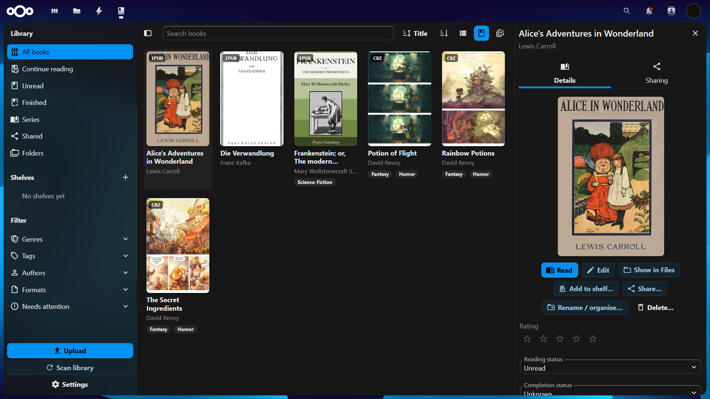
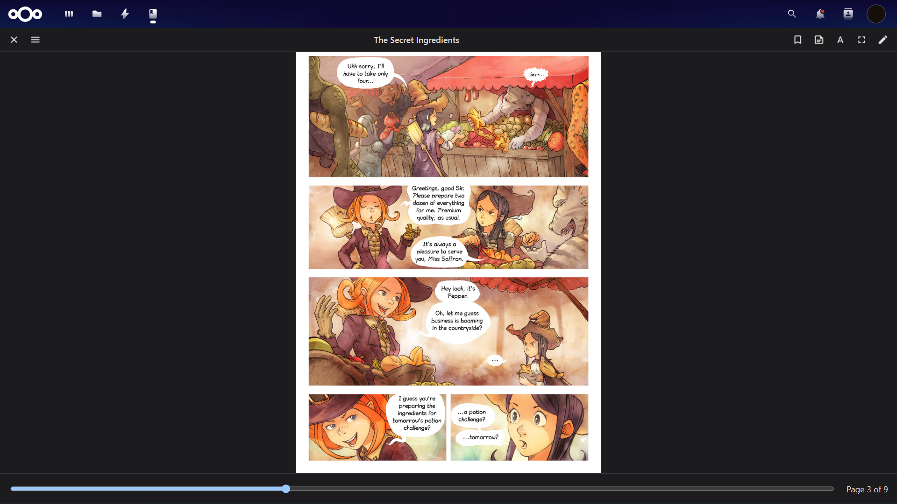
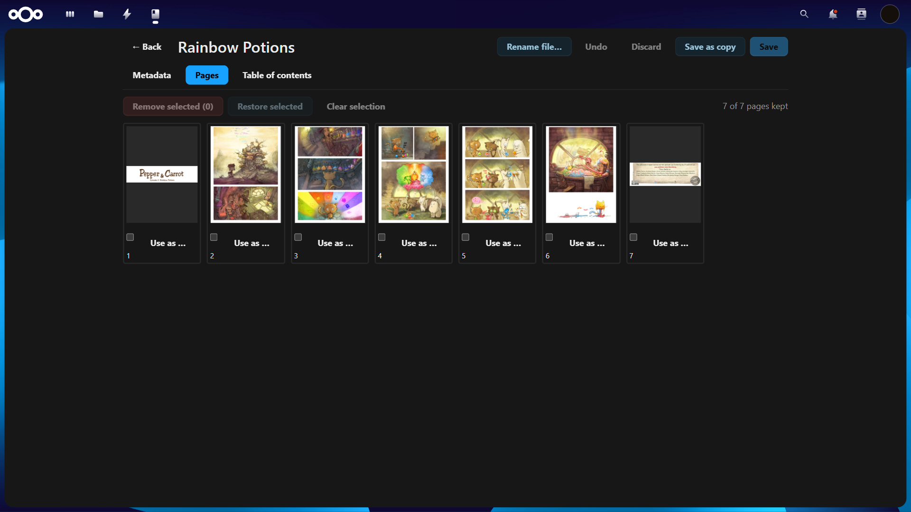
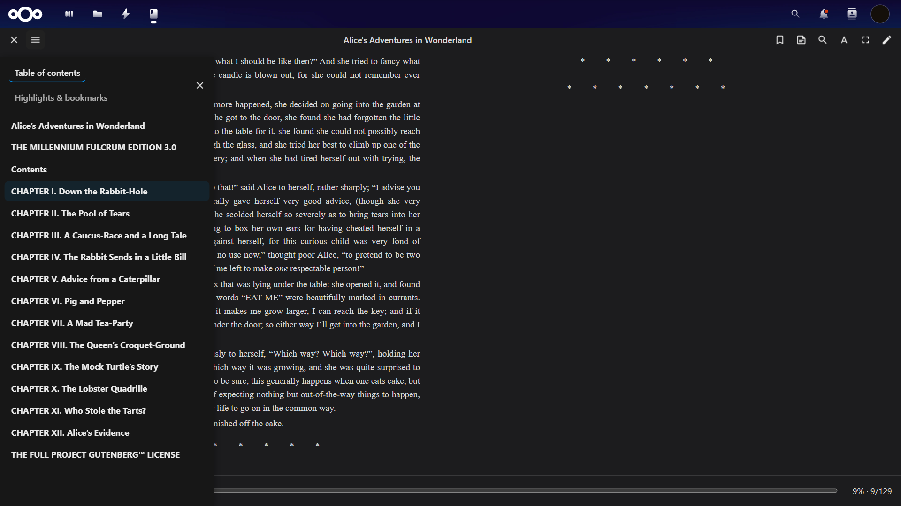
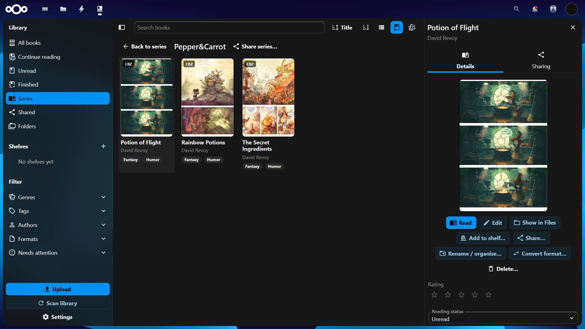

🇬🇧 **English** | [🇩🇪 Deutsch](docs/translations/README.de.md)

# E-Book Reader for Nextcloud

E-Book Reader is a library, reader and editor for e-books and comics inside Nextcloud. Your books stay ordinary files in your Nextcloud storage: the app indexes them, presents them as a browsable library, and keeps your reading position in sync across all your devices.

It is a regular Nextcloud app (PHP backend, Vue frontend). It needs no extra container, database or external service; optional archive tools on the server (7-Zip, bsdtar) enable server-side handling of RAR and 7z comics.

[](https://github.com/SomeCatCode/nextcloud_ebook_reader/actions/workflows/ci.yml)
[](https://github.com/SomeCatCode/nextcloud_ebook_reader/releases)


<a href="https://ateeducacion.github.io/nextcloud-playground/?blueprint-url=https://raw.githubusercontent.com/SomeCatCode/nextcloud_ebook_reader/playground/blueprint.json" target="_blank" rel="noopener noreferrer"></a>

Try the app without a server: [Nextcloud Playground](playground/README.md) runs Nextcloud with the E-Book Reader and six free sample books in your browser. Nothing leaves the browser.

## Android app

[](https://play.google.com/store/apps/details?id=com.somecatcode.ebookreader)

[Ebook Reader for Nextcloud](https://play.google.com/store/apps/details?id=com.somecatcode.ebookreader) is the companion app for Android. It is available on Google Play.

- It reads the books of this Nextcloud app and syncs reading position, highlights, notes and shelves.
- It saves books, shelves and series for offline reading.
- It reads books aloud with the voices of the device.
- It also works without a server, with folders on the phone.

The Android app is not open source. Its source code is public for reference in the repository [nextcloud_ebook_reader_app](https://github.com/SomeCatCode/nextcloud_ebook_reader_app), under a proprietary license. The AGPL of this Nextcloud app does not apply to the Android app. Each release there also has an APK file.

For a Nextcloud account, the Android app needs this Nextcloud app (version 0.5.0 or later) on the server. Install it from the [Nextcloud App Store](https://apps.nextcloud.com/apps/ebookreader).











<sub>Screenshots show [Pepper&amp;Carrot](https://www.peppercarrot.com) by David Revoy, licensed under [CC BY 4.0](https://creativecommons.org/licenses/by/4.0/), and public-domain books from [Project Gutenberg](https://www.gutenberg.org).</sub>

> [!NOTE]
> **Stable since 1.0.** The app is in daily production use with a large library (e-books and comics up to 400 MB) and covered by automated tests. The API `v1` is stable. The editor modifies files; Nextcloud keeps a version of every change, but a backup of your books is still a good idea.

## Requirements

- Nextcloud 33 to 35
- PHP 8.2 or later with `zip`, `gd`, `dom`, `libxml`, `mbstring` (included in common installations and the official Docker image)
- Background jobs via **cron** (recommended; with AJAX, large libraries are indexed slowly)
- Optional: **7-Zip** and/or **bsdtar** for CBR and CB7 comics on the server, see [Archive tools](#archive-tools-optional)
- A current Firefox, Chrome/Edge or Safari

## Installation

### From the Nextcloud App Store (recommended)

The app is in the [Nextcloud App Store](https://apps.nextcloud.com/apps/ebookreader).

1. Open **Apps** in Nextcloud as an administrator.
2. Search for "E-Book Reader".
3. Click **Download and enable**.

Or use the command line:

```sh
sudo -u www-data php occ app:install ebookreader
```

### From a release package

As an alternative, install the app from a release package. The [releases page](https://github.com/SomeCatCode/nextcloud_ebook_reader/releases/latest) has the file `ebookreader.tar.gz`. Unpack it into the app directory (usually `custom_apps/`), set the owner, and enable the app:

```sh
cd /var/www/nextcloud/custom_apps
curl -L https://github.com/SomeCatCode/nextcloud_ebook_reader/releases/latest/download/ebookreader.tar.gz | tar -xz
chown -R www-data:www-data ebookreader
sudo -u www-data php /var/www/nextcloud/occ app:enable ebookreader
```

Instead of the last command, you can enable the app in Nextcloud under **Apps → Disabled apps**.

Each release also ships `ebookreader.tar.gz.sha256` for verification (`sha256sum -c ebookreader.tar.gz.sha256`).

### Docker

The app belongs in `/var/www/html/custom_apps/ebookreader` inside the Nextcloud container and must be owned by `www-data`. `occ` runs as `www-data`. The commands are for the official image (`nextcloud` is the container name):

```sh
curl -LO https://github.com/SomeCatCode/nextcloud_ebook_reader/releases/latest/download/ebookreader.tar.gz && tar -xzf ebookreader.tar.gz
docker cp ebookreader nextcloud:/var/www/html/custom_apps/
docker exec -u root nextcloud chown -R www-data:www-data /var/www/html/custom_apps/ebookreader
docker exec -u www-data nextcloud php occ app:enable ebookreader
```

As an alternative to `docker cp`, mount the folder as a volume in the Compose file: `- ./ebookreader:/var/www/html/custom_apps/ebookreader`.

The official image does not run cron by itself; add a service with the same volumes:

```yaml
  cron:
    image: nextcloud:34-apache
    entrypoint: /cron.sh
    volumes:
      - nextcloud:/var/www/html
```

### Nextcloud All-in-One

Use the same commands as in [Docker](#docker) with the container name `nextcloud-aio-nextcloud`. Cron and write permissions are already set up in All-in-One.

### From source

This requires Node.js 22 or 24. No Composer packages are needed at runtime.

```sh
cd /var/www/nextcloud/custom_apps && git clone https://github.com/SomeCatCode/nextcloud_ebook_reader.git ebookreader
cd ebookreader && npm ci && npm run build
sudo -u www-data php /var/www/nextcloud/occ app:enable ebookreader
```

### Updating

Delete the old app folder and put the new release in its place. Then run the migrations and index all libraries again (prefix each command with `docker exec -u www-data <container>` on Docker):

```sh
sudo -u www-data php occ upgrade
sudo -u www-data php occ ebookreader:scan --all
```

### Getting started

1. **Add books:** Put your books into **`/Books`** (default). Other or multiple folders can be chosen in the app settings (bottom left).
2. **Scan the library:** Click **Scan library** once. Afterwards new, changed and deleted books are picked up automatically.
3. **Read:** Click a book and choose **Read**, or open it directly from the Files app.
4. **Complete the metadata:** The navigation entry "Needs attention" lists books without genre, tags and similar fields. Use multi-selection to complete many books at once.

### Archive tools (optional)

CBZ and CBT are handled in PHP, without extra tools. For **CBR** (RAR) and **CB7** (7z) the server needs an archive tool for covers, metadata, page-by-page streaming and conversion; without one, the browser unpacks these files itself (and asks first for files over 50 MB).

The app looks for `unrar`, then `7zz`/`7z`/`7za`, then `bsdtar`, and uses the first one that can read the archive. Recommended: **7-Zip** (for CB7 and CBR) plus **bsdtar** (libarchive), which reads RAR4 and RAR5 even where the 7-Zip package was built without RAR support (Alpine's `7zip`, used by AIO).

| Setup | How |
|---|---|
| Debian / Ubuntu | `sudo apt install 7zip libarchive-tools` (optionally `unrar` from `non-free`) |
| Alpine | `apk add 7zip libarchive-tools` |
| Official Docker image | build your own image, see below |
| Nextcloud AIO | set `NEXTCLOUD_ADDITIONAL_APKS` on the mastercontainer, see below |

**Official Docker image.** The official `nextcloud` image is based on Debian. Packages installed with `docker exec` disappear when the container is recreated. For a permanent installation, use a `Dockerfile` next to your `docker-compose.yml`:

```dockerfile
FROM nextcloud:34-apache
RUN apt-get update \
 && apt-get install -y --no-install-recommends 7zip libarchive-tools \
 && rm -rf /var/lib/apt/lists/*
```

For the FPM variant, use `FROM nextcloud:34-fpm`.

In `docker-compose.yml`, replace `image:` with `build: .` and `pull_policy: build` for **both** the `app` and the `cron` service:

```yaml
services:
  app:
    build: .
    pull_policy: build
    # ... other settings unchanged
  cron:
    build: .
    pull_policy: build
    entrypoint: /cron.sh
    # ...
```

Build and restart. This is also necessary after every Nextcloud update:

```sh
docker compose build --pull && docker compose up -d
```

**Nextcloud All-in-One (AIO).** AIO does not allow a custom image. Install additional Alpine packages with the environment variable `NEXTCLOUD_ADDITIONAL_APKS` of the mastercontainer. The default value is `imagemagick`, so keep it in the list:

- **`docker run`:** add this option when you start the mastercontainer:
  ```sh
  --env NEXTCLOUD_ADDITIONAL_APKS="imagemagick 7zip libarchive-tools"
  ```
- **Compose:** in the service `nextcloud-aio-mastercontainer`:
  ```yaml
  environment:
    - NEXTCLOUD_ADDITIONAL_APKS=imagemagick 7zip libarchive-tools
  ```

Then recreate the mastercontainer with the changed variable, and stop and start the containers from the AIO interface. The packages are then installed at every start of the Nextcloud container.

**Check.** Check what is available:

```sh
docker exec nextcloud-aio-nextcloud sh -c 'command -v 7zz 7z bsdtar unrar'
```

Without Docker, `command -v 7z bsdtar` is sufficient. The convert dialog of the app also shows which conversions run on the server and which run in the browser.

Then re-read the books that were indexed before the tool was installed:

```sh
sudo -u www-data php occ ebookreader:scan <user> --force --format=cbr
```

## Features

### Reading

- EPUB 2/3, MOBI, AZW3 (KF8), FB2, FB2.ZIP and the comic formats CBZ, CBR, CB7, CBT
- Opens from the Files app, with a click or with the action "Open in E-Book Reader"
- Paginated or scrolled layout, light/sepia/dark themes, font, size and line height
- Table of contents, full-text search, keyboard, tap zones and swipe gestures
- Comics as single or double pages, right-to-left (manga) reading direction
- Image filters for comic pages: brightness, contrast and grayscale (for bad scans)
- Long strip comics (webtoons) scroll down seamlessly instead of paging; recognised from ComicInfo.xml (`Format` Webtoon/Long Strip) or set per book
- Highlights in five colours, notes and bookmarks (also for comics), stored on the server, listed in the side panel "Highlights & bookmarks" and exportable as Markdown
- Large files open fast: comic pages are streamed one by one and scaled to the screen size on the server, EPUBs are loaded chapter by chapter. The first page appears immediately.
- Reading position stored on the server and the same on every device; a newer position from another device is offered when you open a book
- Public link shares: guests read a shared book in the browser without an account. The browser keeps the position. Shares with "hide download" are not opened.

### Library

- Cover grid or list with progress and a "Continue reading" row; finished books are hidden by default ("Hide finished books" is on)
- Metadata and covers are read from the files automatically; new, changed and deleted books are detected automatically
- Browse by genre, tag, author, series and format; hierarchical genres and tags (`Fantasy/High Fantasy`)
- Combinable filters (include/exclude, match all or any) with search and sort, kept in the URL, so a filter can be saved as a browser bookmark
- "Needs attention" view for books without genre, tags, author, series, description, cover or language
- Manual shelves with custom order and smart shelves that always show the current result of a saved filter
- Series grouping: one card per series with volume count and progress
- Bulk editing of authors, series (with automatic numbering), publisher, language, genres and tags; bulk shelving, renaming, sorting into folders and deleting (to the trash)
- Drag-and-drop upload, including very large files
- Star ratings and read status (unread, reading, finished)
- Completion status per book (ongoing or completed) and an optional age rating (0, 6, 12, 16, 18; read from ComicInfo.xml `AgeRating` or EPUB `schema:typicalAgeRange`, or set by hand), both shown on the cards and filterable
- "Continue the series": the next volume appears in "Continue reading" once a volume is finished, and the reader offers it at the end of a book
- "Continue reading" dashboard widget: shows the books in progress on the Nextcloud dashboard, with cover, author and progress. A click opens the book in the reader.
- [OPDS catalog](#opds-catalog) for e-reader apps such as KOReader, Moon+ Reader or Thorium: browse the library and download books
- Reading suggestions at the end of a book: the next volume and similar unread titles (same author, genre or tag)
- Sharing with Nextcloud users and groups: single books, shelves, series (later volumes follow) and folders, read-only. The "Sharing" tab of a book lists everyone who has access, also through folders and Nextcloud shares, and removes an access with one click
- User interface in 12 languages: English, German, Spanish, French, Italian, Portuguese (Brazil), Japanese, Korean, Chinese (Simplified), Arabic, Turkish and Dari

### Editing

- Metadata: title, authors, series and index, description, genres, tags, language, publisher, date, ISBN
- Replace the cover (upload, or use a page)
- Remove chapters or pages and reorder them with drag and drop, edit the table of contents
- Rename and sort into folders by pattern, e.g. `{author}/{series}/{series_index} - {title}`, with a preview before the change. `{series_index}` is zero-padded to the width of the highest volume number of the series (01 … 10, 001 … 120), `{series_index:raw}` is not
- Convert between CBZ, CB7, CBT and fixed-layout EPUB, with the pros and cons of each format explained (CBR cannot be a target: writing RAR requires proprietary software)
- Optional, lossy image optimization for comics: downscale pages to a height of 2560 or 1920 px and, if you want, convert PNG pages to JPEG, with a size estimate before the start and a bulk mode for several selected comics. The files become smaller, so downloads and offline use become faster. The downscale cannot be undone; the original goes to the trash if you select that option.
- Save or "Save as copy"; long operations continue on the server with a progress indicator

| | EPUB | CBZ | FB2 | CBR / CB7 / CBT | MOBI / AZW3 |
|---|:-:|:-:|:-:|:-:|:-:|
| Metadata, genres, tags | ✅ | ✅ | ✅ | ✅¹ | ✅¹ |
| Replace cover | ✅ | ✅ | ✅ | ✅² | – |
| Reorder/remove chapters or pages | ✅ | ✅ | ✅ | ✅² | – |
| Edit table of contents | ✅ | ✅ | ✅ | ✅² | – |

¹ stored in the sidecar file (see below); the book file stays untouched<br>
² after converting to CBZ, which the editor offers with one click

## Where metadata is stored

The setting "Where to store metadata changes" decides where edits go:

| Target | Effect |
|---|---|
| **Sidecar file** (default) | A small hidden file `.<book file>.opf` next to the book, e.g. `.Golden Boy 01.cbz.opf` (Calibre-compatible OPF 2.0). Fast, works for every format, never touches the book, and travels with copies, sync and backups. |
| Inside the book | Written into the book itself (EPUB, CBZ, FB2, FBZ) so other readers see it; in the background or immediately. |
| Sidecar file and inside the book | Sidecar immediately, book file according to the setting above. |
| Library only | Only in the app's database, e.g. for read-only folders. |

Precedence when indexing: fields edited in the app, then the sidecar, then the book's embedded metadata, then the file name. Renaming, moving, converting and deleting take the sidecar along. "Write metadata into the book file" in the book details copies the values into the book later, e.g. for Kobo or KOReader.

## OPDS catalog

E-reader apps can browse your library and download books over OPDS 1.2 (Atom), without a browser.

1. In the app, open **Settings** (bottom left). In the section "OPDS catalog", switch on "Enable the OPDS catalog for my account". The catalog is off by default.
2. Copy the **catalog URL** that the section shows, e.g. `https://cloud.example.com/index.php/apps/ebookreader/opds`.
3. Create an **app password** under Nextcloud *Settings → Security*. Enter your user name and this app password in the reader app (HTTP Basic), not your normal password. An app password can be revoked individually at any time.

**Content.** The catalog offers recently added, continue reading, all books, authors, series, genres, tags and shelves (including smart shelves), plus a search (OpenSearch). Lists have 50 books per page. Each book has cover, description, authors, series, genres and tags, and a download in the original format. The catalog shows only books of your library. Files from shares without download permission are not served.

**Admin switch.** Administrators can disable the catalog for the whole server, in the same section of the app settings ("Allow the OPDS catalog on this server") or with `occ`. When the catalog is disabled, no user can reach it, regardless of the user's own setting.

```sh
sudo -u www-data php occ config:app:set ebookreader opds_enabled --value=false --type=boolean
```

**Tested apps.** Until now, only the feeds are validated against the OPDS specification; no reader app was tested individually. The catalog should work with KOReader, Moon+ Reader, Librera, Thorium Reader, and with Panels and Chunky (comics). Please report errors as an issue. Reports about other clients are welcome.

Note: these apps do not sync reading progress over OPDS. The reading progress in the Nextcloud app is not affected.

## Administration

### occ commands

| Command | Purpose |
|---|---|
| `occ ebookreader:scan <user>` | index the library of one user |
| `occ ebookreader:scan --all` | index all libraries |
| `occ ebookreader:scan <user> --force --format=cbr` | also re-read unchanged books, e.g. after installing an archive tool such as `bsdtar` (without `--format`: all formats) |
| `occ ebookreader:inspect <path>` | print the metadata of a file as JSON (troubleshooting) |

### App configuration

| App config key | Default | Meaning |
|---|---|---|
| `max_edit_size_mb` | `500` | maximum file size for the editor |
| `archive_cache_mb` | `2048` | local cache for books on WebDAV, SMB or S3 storage and with server-side encryption |
| `comic_cache_mb` | `2048` | cache of scaled comic pages in app data; the oldest pages are removed above this size |
| `opds_enabled` | `true` | OPDS catalog allowed on this server (each user still enables it) |
| `async_inline` | `true` | run saves and conversions right after the response in the same PHP process (PHP-FPM); `false` leaves them to the background job |

```sh
sudo -u www-data php occ config:app:set ebookreader archive_cache_mb --value=4096 --type=integer
```

### Large libraries and large files

- **Cron:** Use system cron every 5 minutes (`*/5 * * * * php -f /var/www/nextcloud/cron.php`). Files over 20 MB are indexed in the background.
- **Background tasks:** Editor saves, conversions and image optimization run as background tasks with progress. Under PHP-FPM a task starts right after the response. Under `mod_php` the next cron run starts the task, or a dedicated worker:
  ```sh
  sudo -u www-data php occ background-job:worker -t 3600 'OCA\EbookReader\BackgroundJob\RunTaskJob'
  ```
  Set up the worker as a systemd service that restarts automatically. Make sure PHP-FPM's `request_terminate_timeout` does not cut long tasks short.
- **External storage:** If books are on local, unencrypted storage, the app reads them directly. Otherwise the app copies each file version at most once into the archive cache (`archive_cache_mb`, in the temporary directory).

## Data layout

- **Your books** stay where they are; the app never moves or copies them on its own. Sidecar files (`.<book file>.opf`) are created next to books when metadata is edited.
- **Database tables** (prefix `ebookreader_`): `books`, `tags`, `progress`, `annotations`, `shelves`, `shelf_books`, `tasks`, `file_shares`, `folder_shares`, `series_shares`, `shelf_shares`. Everything is per user and removed when a user is deleted.
- **App data:** cached scaled comic pages (`comic-pages`, bounded by `comic_cache_mb`), regenerated on demand.
- **Temporary directory:** a bounded archive cache (`archive_cache_mb`) for books on external or encrypted storage.

Back up your books and the Nextcloud database as usual; caches can be deleted at any time.

## Contributing

The development setup, checks and local Nextcloud environment are described in [CONTRIBUTING.md](CONTRIBUTING.md). The REST API is documented in [openapi.json](openapi.json), changes are listed in [CHANGELOG.md](CHANGELOG.md), and releases are described in [docs/RELEASING.md](docs/RELEASING.md).

Please report bugs and feature requests as an [issue](https://github.com/SomeCatCode/nextcloud_ebook_reader/issues).

## Security model

- Scripts inside e-books are never executed, remote content (tracking pixels, web fonts) is never loaded, and links open only after confirmation. Details: [docs/SECURITY-READER.md](docs/SECURITY-READER.md).
- Every query and file access is scoped to the logged-in user; shares with "prevent download" are respected (no page, chapter or file delivery). Public link shares give only the shared book, and only when the share allows downloads.
- Archives are read with limits on entry count, size and unsafe paths; external tools are started without a shell, with timeouts and output limits.
- The OPDS catalog is opt-in per user, uses app passwords, and is rate limited and protected against brute force.

Please report security issues according to [SECURITY.md](SECURITY.md).

## Third-party services

None. The app does not contact any external service, contains no analytics, telemetry or tracking, and works fully on your own server. It is an unofficial app, not affiliated with or endorsed by Nextcloud GmbH. Nextcloud is a trademark of Nextcloud GmbH.

## Known limitations

- DRM-protected books (Kindle, Adobe) cannot be opened.
- MOBI/AZW3 files are never modified; their metadata goes to the sidecar file.
- In public link shares, guests cannot add highlights, notes or bookmarks.
- PDF is intentionally not included; Nextcloud has its own viewer.
- **Own Content Security Policy on the web server.** The reader shows chapters and pages in a frame with a `blob:` address and unpacks RAR and 7z archives in a worker with a `blob:` address. The app allows both in the policy that Nextcloud sends. A default installation needs no change. If your web server or reverse proxy sends an additional `Content-Security-Policy` header, the browser applies both policies and the stricter rule wins. Then your header must allow `blob:` in `frame-src` and in `worker-src` (or in `child-src` or `default-src`, if you only set these). Example for Apache: `Header always set Content-Security-Policy "frame-src 'self' blob:; worker-src 'self' blob:;"`. Without `blob:`, the reader shows the message "A security rule of the web server blocks the reader". Up to version 1.0.2 the loading icon turned forever instead.

## Acknowledgements

- [foliate-js](https://github.com/johnfactotum/foliate-js) (MIT) by John Factotum: the reader's rendering engine
- [libarchive.js](https://github.com/nika-begiashvili/libarchivejs) (MIT): unpacking of CBR/CB7 (RAR/7z) in the browser
- [fflate](https://github.com/101arrowz/fflate) (MIT): ZIP creation in the browser

## License

E-Book Reader is licensed under the GNU Affero General Public License, version 3 or later ([AGPL-3.0-or-later](https://www.gnu.org/licenses/agpl-3.0.html)).
