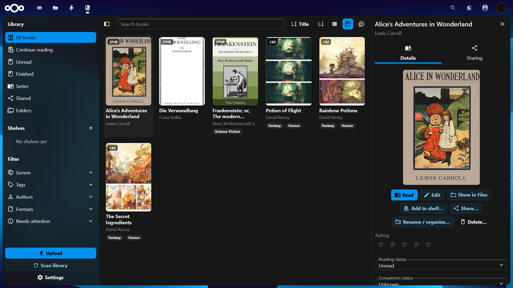
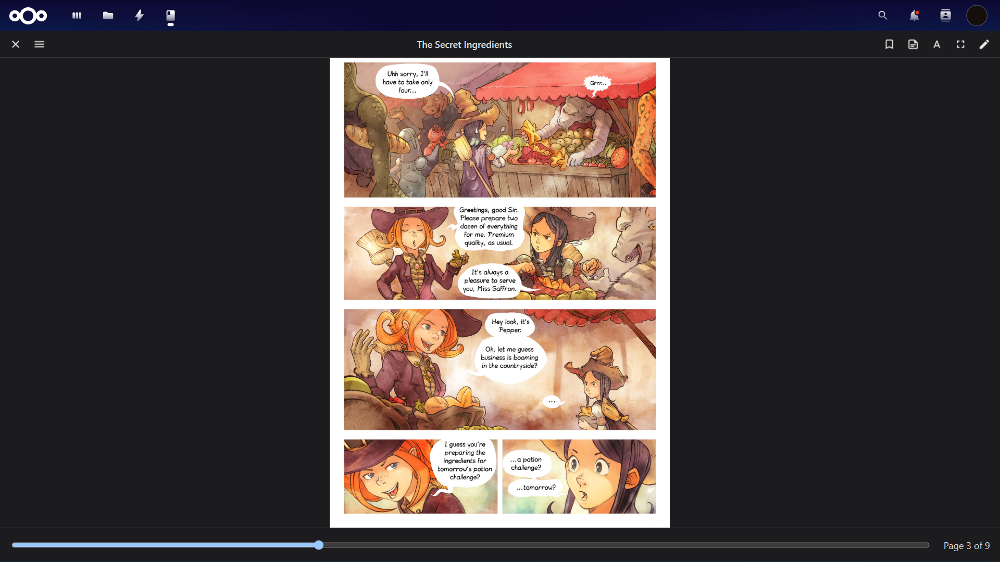
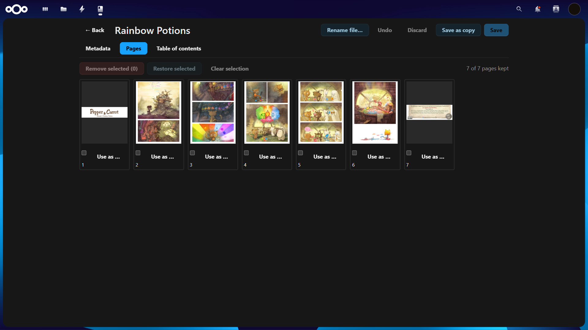
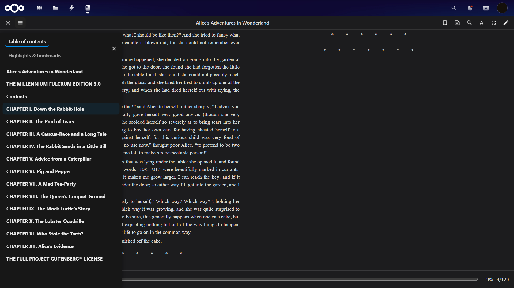
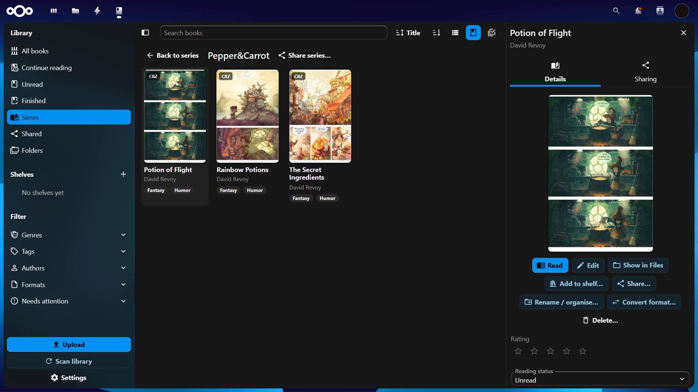

[🇬🇧 English](../../README.md) | 🇩🇪 **Deutsch**

# E-Book Reader für Nextcloud

E-Book Reader ist Bibliothek, Reader und Editor für E-Books und Comics in deiner Nextcloud. Deine Bücher bleiben normale Dateien in deinem Nextcloud-Speicher. Die App liest die Bücher ein und zeigt sie als Bibliothek an. Die App synchronisiert deine Leseposition zwischen all deinen Geräten.

E-Book Reader ist eine normale Nextcloud-App (PHP-Backend, Vue-Frontend). Die App braucht keinen zusätzlichen Container, keine zusätzliche Datenbank und keinen externen Dienst. Optionale Archiv-Programme auf dem Server (7-Zip, bsdtar) ermöglichen es, RAR- und 7z-Comics auf dem Server zu verarbeiten.

[](https://github.com/SomeCatCode/nextcloud_ebook_reader/actions/workflows/ci.yml)
[](https://github.com/SomeCatCode/nextcloud_ebook_reader/releases)


<a href="https://ateeducacion.github.io/nextcloud-playground/?blueprint-url=https://raw.githubusercontent.com/SomeCatCode/nextcloud_ebook_reader/playground/blueprint.json" target="_blank" rel="noopener noreferrer"></a>

Probiere die App ohne Server aus: Der [Nextcloud Playground](../../playground/README.md) startet Nextcloud mit dem E-Book Reader und sechs freien Beispielbüchern in deinem Browser. Keine Daten verlassen den Browser.

## Android-App

[](https://play.google.com/store/apps/details?id=com.somecatcode.ebookreader)

[Ebook Reader for Nextcloud](https://play.google.com/store/apps/details?id=com.somecatcode.ebookreader) ist die Begleit-App für Android. Du bekommst sie bei Google Play.

- Sie liest die Bücher dieser Nextcloud-App. Sie synchronisiert Leseposition, Markierungen, Notizen und Regale.
- Sie speichert Bücher, Regale und Serien für das Lesen ohne Internet.
- Sie liest Bücher mit den Stimmen des Geräts vor.
- Sie funktioniert auch ohne Server, mit Ordnern auf dem Handy.

Die Android-App ist nicht quelloffen. Der Quellcode ist im Repository [nextcloud_ebook_reader_app](https://github.com/SomeCatCode/nextcloud_ebook_reader_app) öffentlich einsehbar. Die Lizenz ist proprietär. Die AGPL dieser Nextcloud-App gilt nicht für die Android-App. Jedes Release dort enthält auch eine APK-Datei.

Für ein Nextcloud-Konto braucht die Android-App diese Nextcloud-App (ab Version 0.5.0) auf dem Server. Installiere sie aus dem [Nextcloud App Store](https://apps.nextcloud.com/apps/ebookreader).











<sub>Die Screenshots zeigen [Pepper&amp;Carrot](https://www.peppercarrot.com) von David Revoy, lizenziert unter [CC BY 4.0](https://creativecommons.org/licenses/by/4.0/deed.de), und gemeinfreie Bücher von [Project Gutenberg](https://www.gutenberg.org).</sub>

> [!NOTE]
> **Stabil seit 1.0.** Die App ist täglich produktiv mit einer großen Bibliothek im Einsatz (E-Books und Comics bis 400 MB). Automatische Tests decken die App ab. Die API `v1` ist stabil. Der Editor verändert Dateien. Nextcloud legt bei jeder Änderung eine Version an. Ein Backup deiner Bücher ist trotzdem sinnvoll.

## Voraussetzungen

- Nextcloud 33 bis 35
- PHP 8.2 oder neuer mit `zip`, `gd`, `dom`, `libxml`, `mbstring` (in üblichen Installationen und im offiziellen Docker-Image enthalten)
- Hintergrundjobs über **Cron** (empfohlen; mit AJAX liest die App große Bibliotheken nur langsam ein)
- Optional: **7-Zip** und/oder **bsdtar** für CBR- und CB7-Comics auf dem Server, siehe [Archiv-Programme](#archiv-programme-optional)
- Ein aktueller Firefox, Chrome/Edge oder Safari

## Installation

### Aus dem Nextcloud App Store (empfohlen)

Die App ist im [Nextcloud App Store](https://apps.nextcloud.com/apps/ebookreader).

1. Öffne in Nextcloud als Administrator **Apps**.
2. Suche „E-Book Reader“.
3. Klicke **Herunterladen und aktivieren**.

Oder nutze die Kommandozeile:

```sh
sudo -u www-data php occ app:install ebookreader
```

### Aus einem Release-Paket

Als Alternative installierst du die App aus einem Release-Paket. Die [Releases-Seite](https://github.com/SomeCatCode/nextcloud_ebook_reader/releases/latest) enthält die Datei `ebookreader.tar.gz`. Entpacke die Datei in das App-Verzeichnis (meist `custom_apps/`), setze den Besitzer und aktiviere die App:

```sh
cd /var/www/nextcloud/custom_apps
curl -L https://github.com/SomeCatCode/nextcloud_ebook_reader/releases/latest/download/ebookreader.tar.gz | tar -xz
chown -R www-data:www-data ebookreader
sudo -u www-data php /var/www/nextcloud/occ app:enable ebookreader
```

Statt des letzten Befehls kannst du die App in Nextcloud unter **Apps → Deaktivierte Apps** aktivieren.

Jedes Release enthält auch die Datei `ebookreader.tar.gz.sha256` zur Prüfung (`sha256sum -c ebookreader.tar.gz.sha256`).

### Docker

Die App gehört nach `/var/www/html/custom_apps/ebookreader` im Nextcloud-Container. Der Ordner muss `www-data` gehören. `occ` läuft als `www-data`. Die Befehle gelten für das offizielle Image (`nextcloud` ist der Container-Name):

```sh
curl -LO https://github.com/SomeCatCode/nextcloud_ebook_reader/releases/latest/download/ebookreader.tar.gz && tar -xzf ebookreader.tar.gz
docker cp ebookreader nextcloud:/var/www/html/custom_apps/
docker exec -u root nextcloud chown -R www-data:www-data /var/www/html/custom_apps/ebookreader
docker exec -u www-data nextcloud php occ app:enable ebookreader
```

Als Alternative zu `docker cp` bindest du den Ordner als Volume in der Compose-Datei ein: `- ./ebookreader:/var/www/html/custom_apps/ebookreader`.

Das offizielle Image führt Cron nicht selbst aus. Ergänze einen Service mit denselben Volumes:

```yaml
  cron:
    image: nextcloud:34-apache
    entrypoint: /cron.sh
    volumes:
      - nextcloud:/var/www/html
```

### Nextcloud All-in-One

Nutze dieselben Befehle wie unter [Docker](#docker) mit dem Container-Namen `nextcloud-aio-nextcloud`. Cron und Schreibrechte sind bei All-in-One schon eingerichtet.

### Aus dem Quellcode

Dafür brauchst du Node.js 22 oder 24. Zur Laufzeit sind keine Composer-Pakete nötig.

```sh
cd /var/www/nextcloud/custom_apps && git clone https://github.com/SomeCatCode/nextcloud_ebook_reader.git ebookreader
cd ebookreader && npm ci && npm run build
sudo -u www-data php /var/www/nextcloud/occ app:enable ebookreader
```

### Update

Lösche den alten App-Ordner und lege das neue Release an dieselbe Stelle. Führe dann die Migrationen aus und lies alle Bibliotheken neu ein. Unter Docker stellst du jedem Befehl `docker exec -u www-data <container>` voran.

```sh
sudo -u www-data php occ upgrade
sudo -u www-data php occ ebookreader:scan --all
```

### Erste Schritte

1. **Bücher ablegen:** Lege deine Bücher in den Ordner **`/Books`** (Standard). In den Einstellungen der App (unten links) kannst du andere oder mehrere Ordner wählen.
2. **Bibliothek scannen:** Klicke einmal auf **Bibliothek scannen**. Danach erkennt die App neue, geänderte und gelöschte Bücher automatisch.
3. **Lesen:** Klicke ein Buch an und wähle **Lesen**, oder öffne das Buch direkt in der Dateien-App.
4. **Metadaten ergänzen:** Der Eintrag „Benötigt Aufmerksamkeit“ in der Navigation zeigt Bücher ohne Genre, Tags und ähnliche Felder. Mit der Mehrfachauswahl ergänzt du viele Bücher auf einmal.

### Archiv-Programme (optional)

CBZ und CBT verarbeitet die App in PHP, ohne Zusatzprogramme. Für **CBR** (RAR) und **CB7** (7z) braucht der Server ein Archiv-Programm. Das Archiv-Programm liefert Cover, Metadaten, die seitenweise Anzeige und die Konvertierung auf dem Server. Ohne Archiv-Programm entpackt der Browser diese Dateien selbst. Bei Dateien über 50 MB fragt der Browser vorher nach.

Die App sucht zuerst `unrar`, dann `7zz`/`7z`/`7za`, dann `bsdtar`. Die App nutzt das erste Programm, das das Archiv lesen kann. Empfohlen: **7-Zip** (für CB7 und CBR) plus **bsdtar** (libarchive). bsdtar liest RAR4 und RAR5 auch dann, wenn das 7-Zip-Paket ohne RAR-Unterstützung gebaut ist (`7zip` von Alpine, das AIO nutzt).

| System | Vorgehen |
|---|---|
| Debian / Ubuntu | `sudo apt install 7zip libarchive-tools` (optional `unrar` aus `non-free`) |
| Alpine | `apk add 7zip libarchive-tools` |
| Offizielles Docker-Image | eigenes Image bauen, siehe unten |
| Nextcloud AIO | `NEXTCLOUD_ADDITIONAL_APKS` am Mastercontainer setzen, siehe unten |

**Offizielles Docker-Image.** Das offizielle `nextcloud`-Image basiert auf Debian. Pakete, die du mit `docker exec` installierst, gehen beim Neuerstellen des Containers verloren. Für eine dauerhafte Installation nutzt du ein `Dockerfile` neben deiner `docker-compose.yml`:

```dockerfile
FROM nextcloud:34-apache
RUN apt-get update \
 && apt-get install -y --no-install-recommends 7zip libarchive-tools \
 && rm -rf /var/lib/apt/lists/*
```

Für die FPM-Variante nutzt du `FROM nextcloud:34-fpm`.

Ersetze in der `docker-compose.yml` bei **beiden** Services (`app` und `cron`) `image:` durch `build: .` und `pull_policy: build`:

```yaml
services:
  app:
    build: .
    pull_policy: build
    # ... restliche Einstellungen unverändert
  cron:
    build: .
    pull_policy: build
    entrypoint: /cron.sh
    # ...
```

Baue das Image und starte die Container neu. Das ist auch nach jedem Nextcloud-Update nötig:

```sh
docker compose build --pull && docker compose up -d
```

**Nextcloud All-in-One (AIO).** AIO erlaubt kein eigenes Image. Installiere zusätzliche Alpine-Pakete mit der Umgebungsvariable `NEXTCLOUD_ADDITIONAL_APKS` des Mastercontainers. Der Standardwert ist `imagemagick`. Gib `imagemagick` deshalb mit an:

- **`docker run`:** Ergänze diese Option beim Start des Mastercontainers:
  ```sh
  --env NEXTCLOUD_ADDITIONAL_APKS="imagemagick 7zip libarchive-tools"
  ```
- **Compose:** im Service `nextcloud-aio-mastercontainer`:
  ```yaml
  environment:
    - NEXTCLOUD_ADDITIONAL_APKS=imagemagick 7zip libarchive-tools
  ```

Erstelle danach den Mastercontainer mit der geänderten Variable neu. Stoppe und starte dann die Container in der AIO-Oberfläche. Der Nextcloud-Container installiert die Pakete dann bei jedem Start.

**Prüfen.** Prüfe, welche Programme vorhanden sind:

```sh
docker exec nextcloud-aio-nextcloud sh -c 'command -v 7zz 7z bsdtar unrar'
```

Ohne Docker genügt `command -v 7z bsdtar`. Der Konvertieren-Dialog der App zeigt außerdem, welche Umwandlungen auf dem Server laufen und welche im Browser.

Lies danach die Bücher neu ein, die die App vor der Installation des Programms eingelesen hat:

```sh
sudo -u www-data php occ ebookreader:scan <benutzer> --force --format=cbr
```

## Funktionen

### Lesen

- EPUB 2/3, MOBI, AZW3 (KF8), FB2, FB2.ZIP und die Comic-Formate CBZ, CBR, CB7, CBT
- Öffnen aus der Dateien-App, per Klick oder über die Aktion „Im E-Book-Reader öffnen“
- Paginierte oder scrollende Darstellung, Themes hell, sepia und dunkel, Schriftart, Schriftgröße und Zeilenhöhe
- Inhaltsverzeichnis, Volltextsuche, Tastatur, Tipp-Zonen und Wischgesten
- Comics als Einzel- oder Doppelseite, Leserichtung rechts nach links (Manga)
- Bildfilter für Comic-Seiten: Helligkeit, Kontrast und Graustufen (für schlechte Scans)
- Longstrip-Comics (Webtoons) scrollen nahtlos nach unten statt zu blättern. Die App erkennt sie an ComicInfo.xml (`Format` Webtoon/Long Strip). Du kannst die Einstellung pro Buch ändern.
- Markierungen in fünf Farben, Notizen und Lesezeichen (auch für Comics). Der Server speichert sie. Das Seitenpanel „Markierungen & Lesezeichen“ listet sie auf. Du kannst sie als Markdown exportieren.
- Große Dateien öffnen schnell: Der Server liefert Comic-Seiten einzeln und verkleinert sie auf Bildschirmgröße. Die App lädt EPUBs kapitelweise. Die erste Seite erscheint sofort.
- Der Server speichert die Leseposition. Die Leseposition ist auf jedem Gerät dieselbe. Wenn ein anderes Gerät eine neuere Leseposition hat, bietet die App sie beim Öffnen des Buchs an.
- Öffentliche Freigabe-Links: Gäste lesen ein geteiltes Buch im Browser ohne Konto. Der Browser merkt sich die Leseposition. Freigaben mit „Download verbergen“ öffnet der Reader nicht.

### Bibliothek

- Cover-Raster oder Liste mit Lesefortschritt und einer „Weiterlesen“-Leiste. Gelesene Bücher sind standardmäßig ausgeblendet („Gelesene Bücher ausblenden“ ist an).
- Die App liest Metadaten und Cover automatisch aus den Dateien. Die App erkennt neue, geänderte und gelöschte Bücher automatisch.
- Navigation nach Genre, Tag, Autor, Serie und Format. Genres und Tags können hierarchisch sein (`Fantasy/High Fantasy`).
- Kombinierbare Filter (einschließen/ausschließen, „alle“ oder „mindestens einer“) mit Suche und Sortierung. Der Filter steht in der URL. Du kannst ihn deshalb als Browser-Lesezeichen speichern.
- Ansicht „Benötigt Aufmerksamkeit“ für Bücher ohne Genre, Tags, Autor, Serie, Beschreibung, Cover oder Sprache
- Manuelle Regale mit eigener Reihenfolge und smarte Regale. Ein smartes Regal zeigt immer das aktuelle Ergebnis eines gespeicherten Filters.
- Serien zusammenfassen: eine Karte pro Serie mit Bandanzahl und Lesefortschritt
- Mehrfachbearbeitung von Autoren, Serie (mit automatischer Bandnummerierung), Verlag, Sprache, Genres und Tags. Außerdem für viele Bücher auf einmal: in Regale legen, umbenennen, in Ordner einsortieren und löschen (in den Papierkorb).
- Hochladen per Drag & Drop, auch sehr große Dateien
- Bewertung mit Sternen und Lesestatus (ungelesen, lese gerade, gelesen)
- Status pro Buch (laufend oder abgeschlossen) und optionale Altersfreigabe (0, 6, 12, 16, 18; aus ComicInfo.xml `AgeRating` oder EPUB `schema:typicalAgeRange` gelesen oder von Hand gesetzt). Die Karten zeigen beides. Du kannst nach beidem filtern.
- „Serie fortsetzen“: Wenn du einen Band gelesen hast, erscheint der nächste Band unter „Weiterlesen“. Der Reader bietet den nächsten Band am Ende eines Buchs an.
- Dashboard-Widget „Weiterlesen“: Das Widget zeigt auf dem Nextcloud-Dashboard die angefangenen Bücher mit Cover, Autor und Lesefortschritt. Ein Klick öffnet das Buch im Reader.
- [OPDS-Katalog](#opds-katalog) für E-Reader-Apps wie KOReader, Moon+ Reader oder Thorium: Bibliothek durchsuchen und Bücher herunterladen
- Lesevorschläge am Ende eines Buchs: der nächste Band und ähnliche ungelesene Titel (gleicher Autor, gleiches Genre oder gleicher Tag)
- Teilen mit Nextcloud-Benutzern und -Gruppen: einzelne Bücher, Regale, Serien (spätere Bände kommen automatisch dazu) und Ordner, nur lesend. Der Tab „Freigaben“ eines Buchs zeigt alle, die Zugriff haben, auch über Ordner und Nextcloud-Freigaben. Ein Klick entfernt einen Zugriff.
- Oberfläche in 12 Sprachen: Englisch, Deutsch, Spanisch, Französisch, Italienisch, Portugiesisch (Brasilien), Japanisch, Koreanisch, Chinesisch (vereinfacht), Arabisch, Türkisch und Dari

### Bearbeiten

- Metadaten: Titel, Autoren, Serie und Band, Beschreibung, Genres, Tags, Sprache, Verlag, Datum, ISBN
- Cover tauschen (Upload oder eine Seite als Cover wählen)
- Kapitel oder Seiten entfernen und per Drag & Drop umsortieren, Inhaltsverzeichnis bearbeiten
- Umbenennen und in Ordner einsortieren nach Muster, z. B. `{author}/{series}/{series_index} - {title}`, mit Vorschau vor der Änderung. `{series_index}` erhält führende Nullen passend zur höchsten Bandnummer der Serie (01 … 10, 001 … 120), `{series_index:raw}` nicht.
- Konvertieren zwischen CBZ, CB7, CBT und EPUB (Fixed Layout). Die App erklärt die Vor- und Nachteile jedes Formats. CBR kann kein Ziel sein, weil nur proprietäre Software RAR schreiben kann.
- Optionale, verlustbehaftete Bildoptimierung für Comics: Die App verkleinert Seiten auf 2560 px oder 1920 px Höhe und wandelt PNG-Seiten auf Wunsch in JPEG um. Vor dem Start zeigt die App eine Größenschätzung. Die Bildoptimierung geht auch für mehrere markierte Comics auf einmal. Die Dateien werden kleiner. Downloads und Offline-Nutzung werden dadurch schneller. Du kannst das Verkleinern nicht rückgängig machen. Das Original landet im Papierkorb, wenn du diese Option wählst.
- Speichern oder „Als Kopie speichern“. Lange Vorgänge laufen auf dem Server mit Fortschrittsanzeige weiter.

| | EPUB | CBZ | FB2 | CBR / CB7 / CBT | MOBI / AZW3 |
|---|:-:|:-:|:-:|:-:|:-:|
| Metadaten, Genres, Tags | ✅ | ✅ | ✅ | ✅¹ | ✅¹ |
| Cover tauschen | ✅ | ✅ | ✅ | ✅² | – |
| Kapitel oder Seiten umsortieren/entfernen | ✅ | ✅ | ✅ | ✅² | – |
| Inhaltsverzeichnis bearbeiten | ✅ | ✅ | ✅ | ✅² | – |

¹ in der Sidecar-Datei gespeichert (siehe unten); die Buchdatei bleibt unverändert<br>
² nach der Umwandlung in CBZ, die der Editor per Klick anbietet

## Wo Metadaten gespeichert werden

Die Einstellung „Wo Metadaten-Änderungen gespeichert werden“ legt fest, wohin die App Änderungen schreibt:

| Ziel | Wirkung |
|---|---|
| **Sidecar-Datei** (Standard) | Eine kleine, versteckte Datei `.<Buchdatei>.opf` neben dem Buch, z. B. `.Golden Boy 01.cbz.opf` (Calibre-kompatibles OPF 2.0). Schnell, für alle Formate, die Buchdatei bleibt unverändert. Die Sidecar-Datei wandert bei Kopie, Sync und Backup mit. |
| Im Buch | Die App schreibt die Metadaten in das Buch selbst (EPUB, CBZ, FB2, FBZ). Andere Reader sehen die Metadaten dann auch. Das Schreiben läuft im Hintergrund oder sofort. |
| Sidecar-Datei und im Buch | Die Sidecar-Datei sofort, die Buchdatei nach der Einstellung oben. |
| Nur Bibliothek | Nur in der Datenbank der App, z. B. bei schreibgeschützten Ordnern. |

Rangfolge beim Einlesen: in der App geänderte Felder, dann die Sidecar-Datei, dann die Metadaten im Buch, dann der Dateiname. Beim Umbenennen, Verschieben, Konvertieren und Löschen wandert die Sidecar-Datei mit. „Metadaten in die Buchdatei schreiben“ in den Buchdetails überträgt die Werte später in das Buch, z. B. für Kobo oder KOReader.

## OPDS-Katalog

E-Reader-Apps durchsuchen deine Bibliothek über OPDS 1.2 (Atom) und laden Bücher herunter, ohne Browser.

1. Öffne in der App die **Einstellungen** (unten links). Schalte im Abschnitt „OPDS-Katalog“ die Option „Den OPDS-Katalog für mein Konto aktivieren“ ein. Der Katalog ist standardmäßig aus.
2. Kopiere die **Katalog-URL**, die der Abschnitt anzeigt, z. B. `https://cloud.example.com/index.php/apps/ebookreader/opds`.
3. Erstelle in Nextcloud unter *Einstellungen → Sicherheit* ein **App-Passwort**. Trage in der Reader-App deinen Benutzernamen und dieses App-Passwort ein (HTTP Basic), nicht dein normales Passwort. Ein App-Passwort kannst du jederzeit einzeln widerrufen.

**Inhalt.** Der Katalog bietet Neu hinzugefügt, Weiterlesen, Alle Bücher, Autoren, Serien, Genres, Tags und Regale (auch smarte Regale), dazu eine Suche (OpenSearch). Listen haben 50 Bücher pro Seite. Jedes Buch hat Cover, Beschreibung, Autoren, Serie, Genres und Tags sowie einen Download im Originalformat. Der Katalog zeigt nur Bücher aus deiner Bibliothek. Dateien aus Freigaben ohne Download-Recht liefert der Katalog nicht aus.

**Admin-Schalter.** Administratoren können den Katalog für den ganzen Server sperren. Das geht im selben Abschnitt der App-Einstellungen („Den OPDS-Katalog auf diesem Server erlauben“) oder mit `occ`. Wenn der Katalog gesperrt ist, kann kein Benutzer ihn erreichen, unabhängig von der eigenen Einstellung.

```sh
sudo -u www-data php occ config:app:set ebookreader opds_enabled --value=false --type=boolean
```

**Getestete Apps.** Bisher sind nur die Feeds gegen die OPDS-Spezifikation geprüft. Keine Reader-App wurde einzeln getestet. Der Katalog sollte mit KOReader, Moon+ Reader, Librera, Thorium Reader sowie mit Panels und Chunky (Comics) funktionieren. Melde Fehler bitte als Issue. Berichte über andere Apps sind willkommen.

Hinweis: Diese Apps synchronisieren den Lesefortschritt nicht über OPDS. Der Lesefortschritt in der Nextcloud-App bleibt davon unberührt.

## Administration

### occ-Befehle

| Befehl | Zweck |
|---|---|
| `occ ebookreader:scan <benutzer>` | die Bibliothek eines Benutzers einlesen |
| `occ ebookreader:scan --all` | alle Bibliotheken einlesen |
| `occ ebookreader:scan <benutzer> --force --format=cbr` | auch unveränderte Bücher neu einlesen, z. B. nach der Installation eines Archiv-Programms wie `bsdtar` (ohne `--format`: alle Formate) |
| `occ ebookreader:inspect <pfad>` | die Metadaten einer Datei als JSON ausgeben (Fehlersuche) |

### App-Konfiguration

| Schlüssel der App-Konfiguration | Standard | Bedeutung |
|---|---|---|
| `max_edit_size_mb` | `500` | maximale Dateigröße für den Editor |
| `archive_cache_mb` | `2048` | lokaler Cache für Bücher auf WebDAV-, SMB- oder S3-Speicher und bei serverseitiger Verschlüsselung |
| `comic_cache_mb` | `2048` | Cache für skalierte Comic-Seiten in den App-Daten; über dieser Größe löscht die App die ältesten Seiten |
| `opds_enabled` | `true` | OPDS-Katalog auf diesem Server erlaubt (jeder Benutzer schaltet ihn zusätzlich selbst ein) |
| `async_inline` | `true` | Speichern und Konvertieren direkt nach der Antwort im selben PHP-Prozess ausführen (PHP-FPM); `false` überlässt das dem Hintergrundjob |

```sh
sudo -u www-data php occ config:app:set ebookreader archive_cache_mb --value=4096 --type=integer
```

### Große Bibliotheken und große Dateien

- **Cron:** Nutze System-Cron alle 5 Minuten (`*/5 * * * * php -f /var/www/nextcloud/cron.php`). Dateien über 20 MB liest die App im Hintergrund ein.
- **Hintergrundaufgaben:** Speichern im Editor, Konvertieren und Bildoptimierung laufen als Hintergrundaufgabe mit Fortschritt. Unter PHP-FPM startet eine Aufgabe direkt nach der Antwort. Unter `mod_php` startet der nächste Cron-Lauf die Aufgabe, oder ein dauerhafter Worker:
  ```sh
  sudo -u www-data php occ background-job:worker -t 3600 'OCA\EbookReader\BackgroundJob\RunTaskJob'
  ```
  Richte den Worker als systemd-Dienst ein, der automatisch neu startet. Stelle sicher, dass `request_terminate_timeout` von PHP-FPM lange Aufgaben nicht abbricht.
- **Externer Speicher:** Wenn Bücher auf lokalem, unverschlüsseltem Speicher liegen, liest die App sie direkt. Sonst kopiert die App jede Dateiversion höchstens einmal in den Archiv-Cache (`archive_cache_mb`, im temporären Verzeichnis).

## Datenablage

- **Deine Bücher** bleiben, wo sie sind. Die App verschiebt oder kopiert sie nie von selbst. Wenn du Metadaten änderst, legt die App Sidecar-Dateien (`.<Buchdatei>.opf`) neben den Büchern an.
- **Datenbanktabellen** (Präfix `ebookreader_`): `books`, `tags`, `progress`, `annotations`, `shelves`, `shelf_books`, `tasks`, `file_shares`, `folder_shares`, `series_shares`, `shelf_shares`. Alle Daten gehören zu einem Benutzer. Wenn ein Benutzer gelöscht wird, entfernt die App seine Daten.
- **App-Daten:** Cache für skalierte Comic-Seiten (`comic-pages`, begrenzt durch `comic_cache_mb`). Die App erzeugt die Seiten bei Bedarf neu.
- **Temporäres Verzeichnis:** ein begrenzter Archiv-Cache (`archive_cache_mb`) für Bücher auf externem oder verschlüsseltem Speicher.

Sichere deine Bücher und die Nextcloud-Datenbank wie üblich. Die Caches kannst du jederzeit löschen.

## Mitwirken

[CONTRIBUTING.md](../../CONTRIBUTING.md) beschreibt die Entwicklungsumgebung, die Prüfungen und die lokale Nextcloud-Umgebung. [openapi.json](../../openapi.json) dokumentiert die REST-API. [CHANGELOG.md](../../CHANGELOG.md) listet die Änderungen auf. [docs/RELEASING.md](../RELEASING.md) beschreibt die Releases.

Melde Fehler und Wünsche bitte als [Issue](https://github.com/SomeCatCode/nextcloud_ebook_reader/issues).

## Sicherheitsmodell

- Die App führt Skripte in E-Books nie aus. Die App lädt externe Inhalte (Tracking-Pixel, Web-Fonts) nie nach. Links öffnen erst nach Rückfrage. Details: [docs/SECURITY-READER.md](../SECURITY-READER.md).
- Jede Abfrage und jeder Dateizugriff ist auf den angemeldeten Benutzer beschränkt. Die App respektiert Freigaben mit „Download verbieten“ (keine Auslieferung von Seiten, Kapiteln oder Dateien). Öffentliche Freigabe-Links geben nur das geteilte Buch frei, und nur wenn die Freigabe Downloads erlaubt.
- Die App liest Archive mit Grenzen für Anzahl und Größe der Einträge und lehnt unsichere Pfade ab. Die App startet externe Programme ohne Shell, mit Zeitlimits und Ausgabelimits.
- Jeder Benutzer schaltet den OPDS-Katalog selbst ein (Opt-in). Der OPDS-Katalog nutzt App-Passwörter. Ein Rate-Limit und ein Brute-Force-Schutz sichern den OPDS-Katalog.

Melde Sicherheitsprobleme bitte nach [SECURITY.md](../../SECURITY.md).

## Dienste von Drittanbietern

Keine. Die App kontaktiert keinen externen Dienst. Die App enthält keine Analyse, keine Telemetrie und kein Tracking. Die App funktioniert vollständig auf deinem eigenen Server. E-Book Reader ist eine inoffizielle App. Die App ist nicht mit der Nextcloud GmbH verbunden und wird nicht von ihr unterstützt. Nextcloud ist eine Marke der Nextcloud GmbH.

## Bekannte Einschränkungen

- DRM-geschützte Bücher (Kindle, Adobe) lassen sich nicht öffnen.
- Die App verändert MOBI/AZW3-Dateien nie. Die Metadaten dieser Dateien landen in der Sidecar-Datei.
- In öffentlichen Freigabe-Links können Gäste keine Markierungen, Notizen oder Lesezeichen anlegen.
- PDF ist bewusst nicht dabei. Nextcloud hat dafür einen eigenen Viewer.
- **Eigene Content Security Policy im Webserver.** Der Reader zeigt Kapitel und Seiten in einem Frame mit einer `blob:`-Adresse. RAR- und 7z-Archive entpackt er in einem Worker mit einer `blob:`-Adresse. Die App erlaubt beides in der Policy, die Nextcloud sendet. Eine Standardinstallation braucht keine Änderung. Wenn dein Webserver oder Reverse Proxy einen zusätzlichen Header `Content-Security-Policy` sendet, wendet der Browser beide Policies an, und die strengere Regel gewinnt. Dann muss dein Header `blob:` in `frame-src` und in `worker-src` erlauben (oder in `child-src` oder `default-src`, wenn du nur diese setzt). Beispiel für Apache: `Header always set Content-Security-Policy "frame-src 'self' blob:; worker-src 'self' blob:;"`. Ohne `blob:` zeigt der Reader die Meldung „Eine Sicherheitsregel des Webservers blockiert den Reader“. Bis Version 1.0.2 drehte sich stattdessen das Ladesymbol ohne Ende.

## Danksagung

- [foliate-js](https://github.com/johnfactotum/foliate-js) (MIT) von John Factotum: Rendering-Engine des Readers
- [libarchive.js](https://github.com/nika-begiashvili/libarchivejs) (MIT): Entpacken von CBR/CB7 (RAR/7z) im Browser
- [fflate](https://github.com/101arrowz/fflate) (MIT): ZIP-Erzeugung im Browser

## Lizenz

E-Book Reader ist unter der GNU Affero General Public License, Version 3 oder neuer, lizenziert ([AGPL-3.0-or-later](https://www.gnu.org/licenses/agpl-3.0.html)).
